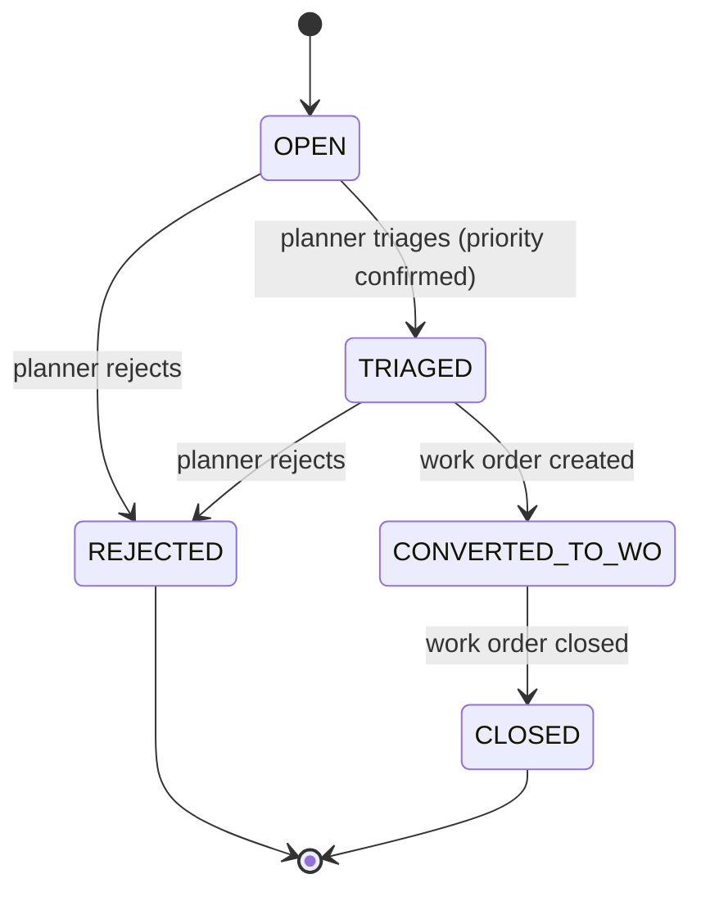
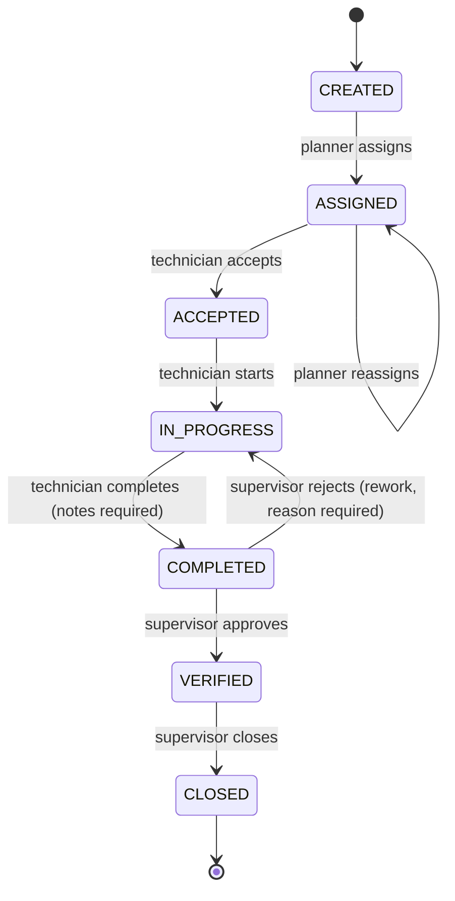
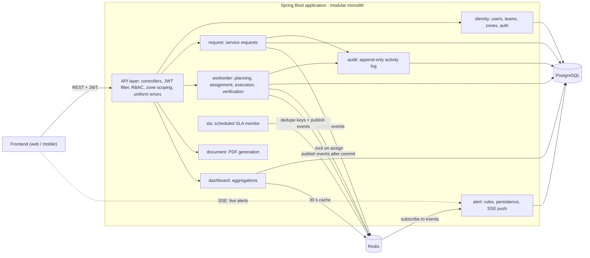
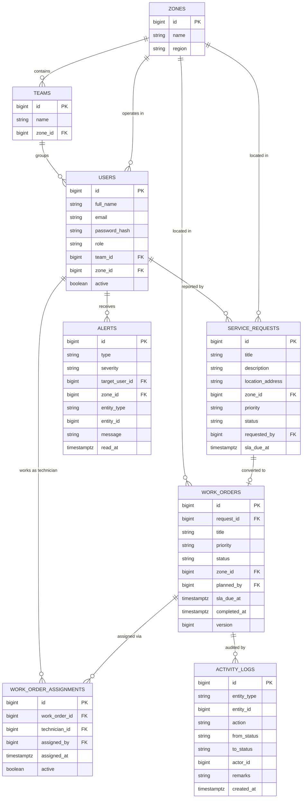

# Field Operations Management System - Backend

A backend for two connected real-world workflows: **Service Request Management** (people report problems) and **Field Maintenance Operations** (technicians fix them on site), with assignment, monitoring, alerts, documents and a full audit trail.

**Stack:** Java 17, Spring Boot 3.3, PostgreSQL 16 (Flyway), Redis 7, JWT security, Docker.

---

## 1. Quick start

Requirements: Docker Desktop only.

```bash
git clone <this-repo>
cd <this-repo>
docker compose up --build        # first build takes a few minutes (Maven downloads dependencies)
```

Wait for `Started FieldOpsApplication`, then open:

| What | URL |
|---|---|
| Swagger UI (try every API) | http://localhost:8081/swagger-ui.html |
| Health check | http://localhost:8081/actuator/health |

Host ports are configurable if they clash with something on your machine:
`APP_PORT=9090 PG_PORT=5432 REDIS_PORT=6380 docker compose up --build`

**Demo users** (created on first start, password for all: `Password@123`)

| Email | Role | Zone |
|---|---|---|
| requester@fieldops.com | REQUESTER | Zone-East |
| planner@fieldops.com | PLANNER | Zone-East |
| supervisor@fieldops.com | SUPERVISOR | Zone-East |
| tech1@ / tech2@ / tech3@fieldops.com | TECHNICIAN | Zone-East |
| admin@fieldops.com | ADMIN | all zones |

**Postman:** import `postman/fieldops.postman_collection.json`. Run folder **0. Auth** first (stores a JWT per role), then **1. Happy path** (a one-click end-to-end run, including both PDFs).
Folder 2 covers the rework loop and validation errors, folder 3 access control, folder 4 alerts and the SLA monitor (send those one by one).

**Run from an IDE instead:** `docker compose up -d postgres redis`, then run `FieldOpsApplication` (defaults point to Postgres on `localhost:5433`, app on port `8081`).

---

## 2. Problem understanding (research summary)

**Service request management** is the intake side of operations. Someone (a customer, a facility user, or a monitoring system) reports a problem. The request is logged, checked, **triaged** (is it valid? how urgent?) and given a **priority** with an **SLA deadline** (e.g. critical = hours, low = days). Nothing is done on site yet - this is about capturing and qualifying demand.

**Field maintenance operations** is the execution side. Approved work becomes a **work order**: the authorised instruction to do a job at a place, with priority and deadline. Maintenance is *corrective* (something broke), *preventive* (scheduled) or *inspection* work. A job moves through planning, dispatch, travel, on-site work, completion, and **supervisor verification** before it is closed. Every step needs to be traceable, because it is used for SLA reporting, billing and disputes.

**How technicians are assigned:** a planner (dispatcher) matches a job to a technician using the **zone/territory**, the technician's **current workload/availability**, and the **priority/SLA** of the job (skills and distance are further factors in real systems). Two planners must never overload the same technician at the same time.

**Who does what**

| Phase | Who | What |
|---|---|---|
| Create | Requester (customer / site user) | Reports the problem |
| Plan | Planner / operations manager | Triages, sets priority, creates the work order, assigns a technician |
| Execute | Field technician | Accepts, works, reports completion with notes |
| Monitor & verify | Supervisor (regional) | Watches the board and delays, verifies or rejects the work, closes it, handles escalations |
| Administer | Admin | Cross-zone access, can trigger the SLA check |

---

## 3. Actors, authentication and access rules

**Authentication assumptions**
- Email + password login returns a signed **JWT** (HMAC, 8 h expiry) carrying `userId`, `role` and `zone`. The API is stateless; every request sends `Authorization: Bearer <token>`.
- Passwords are stored as BCrypt hashes. Users are provisioned by an admin (seeded here). Public self-registration exists but can only ever create the lowest role, `REQUESTER`.

**Access rules** (enforced with `@PreAuthorize` plus service-level checks)

| Action | Requester | Technician | Planner | Supervisor | Admin |
|---|:-:|:-:|:-:|:-:|:-:|
| Create service request | yes | | yes | | yes |
| View requests | own only | | own zone | own zone | all |
| Triage / reject request | | | yes | | yes |
| Create work order, assign / reassign | | | yes | | yes |
| Change priority | | | yes | yes | yes |
| Accept / start / complete work | | own jobs only | | | |
| Verify (approve / reject), close | | | | yes | yes |
| View work orders, history, PDFs | | own jobs only | own zone | own zone | all |
| Dashboard summary | | | own zone | own zone | any zone |
| Trigger SLA check manually | | | | | yes |

**Zone scoping:** planners and supervisors can only see and act on items in their own zone. A technician can only ever see jobs assigned to them.

---

## 4. Lifecycles

**Service request**



**Work order** (the transition table lives in one place: `WorkOrderStatus`, covered by unit tests)



**SLA:** the deadline is `created_at + SLA(priority)`: CRITICAL 4 h, HIGH 24 h, MEDIUM 72 h, LOW 168 h. Changing priority recalculates it.

---

## 5. Architecture

### 5.1 Overview



### 5.2 Service boundaries (microservice view)

The system is designed as these services, and **implemented as one deployable with the same boundaries as packages**:

| Service | Owns | Package | Talks to others via |
|---|---|---|---|
| Identity & Org | users, teams, zones, JWT | `identity`, `security` | JWT claims |
| Request Service | service requests | `request` | events |
| Work Order Service | work orders, assignments, state machine | `workorder` | events |
| Alert / Notification Service | alerts, live delivery | `alert` | consumes events |
| Document Service | PDF rendering | `document` | reads work order + audit |
| SLA Monitor | deadline tracking | `sla` | publishes events |
| Audit | activity log | `audit` | written in the caller's transaction |

Boundary-friendly choices already in the code: entities reference each other **by ID only** (no cross-module JPA relations); modules talk through **domain events** (Redis Pub/Sub) instead of calling each other for side effects; the alert module is only ever reached through events. Honest limitation: `WorkOrderService` still reads the request and user repositories directly - in a real split those become API calls.

### 5.3 Redis usage (where and why)

| Use | Where | Why |
|---|---|---|
| **Distributed lock** `lock:assign:tech:<id>` | `AssignmentFacade` | Two planners assigning to the same technician at the same moment could both pass the "max 3 active jobs" check. The lock serialises them. It wraps the whole DB transaction (a lock released inside the transaction would be freed before the commit). Released with a token-checked Lua script. |
| **Pub/Sub event bus** `fieldops.events` | `EventPublisher` / `NotificationListener` | Decouples business code from notifications. Events are published only **after the DB commit**, so nobody is notified about a change that rolled back. |
| **SETNX dedupe keys** `sla:delayed:*`, `sla:escalated:*` | `SlaMonitor` | The SLA job runs every minute; the key makes each alert fire **once per deadline**, even with several app instances running the job. |
| **Cache** `dashboard:zone:<id>` (30 s TTL) | `DashboardService` | Dashboard aggregations are identical for every supervisor of a zone and polled often. If Redis is down the code falls back to the database. |

Sessions are not in Redis because authentication is stateless JWT.

### 5.4 Real-time mechanism

**Server-Sent Events** (`GET /api/v1/alerts/stream`) with **polling as a fallback** (`GET /api/v1/alerts?unreadOnly=true`, `GET /api/v1/alerts/unread-count`).

Flow: business action -> domain event on Redis -> every app instance receives it -> `AlertDispatcher` decides who must know -> alert saved to PostgreSQL (so offline users still see it later) -> pushed to the user's open SSE connections on that instance.

Why SSE and not WebSocket: all current needs are one-way (server to client), SSE is plain HTTP so the same JWT/auth applies, and browsers reconnect automatically. WebSocket would be the choice if we later need two-way traffic (e.g. live technician location). Frontend note: the native `EventSource` cannot send an `Authorization` header, so use a fetch-based client such as `@microsoft/fetch-event-source`.

**Alert rules**

| Event | Who is alerted | Severity |
|---|---|---|
| New request | Planners of the zone | WARNING for HIGH/CRITICAL, else INFO |
| Work order assigned | The technician | INFO |
| Priority changed | The technician and zone supervisors | WARNING (CRITICAL if raised to CRITICAL) |
| Work completed | Zone supervisors (verification needed) | INFO |
| Supervisor rejects work | The technician (rework) | WARNING |
| SLA deadline passed (`DELAYED`) | Zone planners and the technician | WARNING |
| Still open one full SLA length after the deadline (`ESCALATED`) | Zone supervisors and planners | CRITICAL |

---

## 6. Data design



Design notes
- **Reassignment keeps history:** assignments are never overwritten; the old row is set `active = false`. A **partial unique index** (`work_order_id WHERE active`) makes "one active technician per work order" a database guarantee, not just application logic.
- **Audit trail:** `activity_logs` is append-only and written **in the same transaction** as the change, so the log and the data can never disagree. It stores from/to status, actor and remarks (e.g. the supervisor's rejection reason).
- **Concurrency, three layers:** Redis lock (technician workload), optimistic locking (`version` column) on work orders, and the unique index above.
- Schema is created by Flyway (`V1__init_schema.sql`); Hibernate only validates it.

---

## 7. API contracts

Base path `/api/v1`. All endpoints except auth require `Authorization: Bearer <jwt>`. Full, try-it-out documentation: Swagger UI. A runnable collection with assertions: `postman/`.

| Method | Path | Roles | Purpose |
|---|---|---|---|
| POST | `/auth/login` | public | Get JWT |
| POST | `/auth/register` | public | Self-register (REQUESTER only) |
| POST | `/requests` | REQUESTER, PLANNER, ADMIN | Create service request |
| GET | `/requests?status=&zoneId=&page=&size=` | authenticated (scoped) | List requests |
| GET | `/requests/:id` | authenticated (scoped) | Request detail |
| POST | `/requests/:id/triage` | PLANNER, ADMIN | OPEN -> TRIAGED, optionally adjust priority |
| POST | `/requests/:id/reject` | PLANNER, ADMIN | Reject with reason |
| POST | `/work-orders` | PLANNER, ADMIN | Create from a triaged request |
| GET | `/work-orders?status=&zoneId=&page=&size=` | all but REQUESTER (scoped) | List / board |
| GET | `/work-orders/:id` | all but REQUESTER (scoped) | Detail incl. assigned technician, `overdue` flag |
| POST | `/work-orders/:id/assign` | PLANNER, ADMIN | Assign / reassign technician |
| GET | `/technicians?zoneId=` | PLANNER, SUPERVISOR, ADMIN | Technicians with workload and availability |
| PATCH | `/work-orders/:id/status` | TECHNICIAN (assigned) | ACCEPTED, IN_PROGRESS, COMPLETED |
| POST | `/work-orders/:id/verify` | SUPERVISOR, ADMIN | Approve, or reject for rework |
| POST | `/work-orders/:id/close` | SUPERVISOR, ADMIN | Close order and request |
| PATCH | `/work-orders/:id/priority` | PLANNER, SUPERVISOR, ADMIN | Change priority (recalculates SLA, alerts) |
| GET | `/work-orders/:id/history` | as detail | Audit trail |
| GET | `/work-orders/:id/pdf/work-order` | as detail | Work order PDF (with sign-off boxes) |
| GET | `/work-orders/:id/pdf/completion-report` | as detail | Completion report PDF (needs status COMPLETED or later) |
| GET | `/dashboard/summary?zoneId=` | PLANNER, SUPERVISOR, ADMIN | Counts by status, overdue, critical (cached) |
| GET | `/alerts?unreadOnly=` | authenticated | My alerts (paged) |
| GET | `/alerts/unread-count` | authenticated | Badge count |
| POST | `/alerts/:id/read` | authenticated | Mark read |
| GET | `/alerts/stream` | authenticated | Live alerts (SSE) |
| POST | `/admin/sla-check` | ADMIN | Run the SLA check now |

**Conventions**
- **One error shape** for every failure: `{ timestamp, status, code, message, details }`. `code` is machine readable (`INVALID_TRANSITION`, `TECH_OVERLOADED`, `REMARKS_REQUIRED`, `VALIDATION_FAILED`, ...), `details` carries per-field validation messages. 401 = no/invalid token, 403 = not allowed, 404 = not found, 409 = state conflict.
- Lists are **paginated** (`page`, `size`, `sort`) and always **scoped** to what the caller may see.
- Responses are flat and UI-ready: a work order already contains `assignedTechnicianId`, `overdue` and `slaDueAt`, so a board needs one call.

**How a frontend uses it**

| Screen | Calls |
|---|---|
| Requester portal | `POST /requests`, `GET /requests` |
| Planner board | `GET /requests?status=OPEN`, triage, create work order, `GET /technicians` for the assign dropdown, `POST .../assign` |
| Technician mobile app | `GET /work-orders` (only own jobs), `PATCH .../status`, `GET .../pdf/work-order` |
| Supervisor dashboard | `GET /dashboard/summary`, `GET /work-orders?status=COMPLETED`, verify / close, SSE for live alerts |
| Notification bell | `GET /alerts/unread-count`, `GET /alerts`, SSE stream |

---

## 8. What is implemented vs. skipped

**Implemented (end to end, running in Docker)**
- Authentication (JWT), 5 roles, role- and zone-based access control
- Request management: create, list/filter, triage, reject
- Work orders: create, assign/reassign with workload rule (max 3 active jobs per technician, same zone), technician execution, supervisor verification with rework loop, close, priority change
- Operational monitoring: filtered lists with overdue flag, technician availability, cached dashboard summary
- Alerts: rule-based, persisted, live over SSE, polling fallback; SLA monitor with delay and escalation
- PDFs: work order and completion report (includes SLA result, verifier and audit trail)
- Audit trail for every state change
- Redis: lock, Pub/Sub, dedupe keys, cache
- Dockerised app + PostgreSQL + Redis, Flyway migrations, Postman collection, Swagger, unit tests for the state machine

**Skipped on purpose (time-boxed)**
- Real microservice deployables and an API gateway - the boundaries exist as packages and events (section 5.2)
- Admin CRUD for users, teams and zones (demo data is seeded)
- Photos / attachments and inspection checklists. The "inspection report" document is covered by the completion report built from technician notes
- Email / FCM / WhatsApp delivery (delivery channels are SSE, stored alerts and logs; the event bus makes adding one a new subscriber)
- Skill- and distance-based technician matching, preventive (recurring) maintenance schedules
- Refresh tokens, password reset, token revocation
- Integration tests (only unit tests for the state machine); `ESCALATED` is an alert and audit event, not a work order status

---

## 9. Trade-offs and decisions

| Decision | Why | Cost / what changes in production |
|---|---|---|
| **Modular monolith** instead of 5 services | 36-hour scope; one deployable is easier to run, test and review while keeping clean boundaries | Split along the packages; give each service its own database; replace direct repository reads with API calls |
| **Redis Pub/Sub** as event bus | Already needed for the lock; trivial to operate | Messages are not durable: a subscriber that is down misses events. Alerts are persisted, which softens this. Production: Redis Streams with consumer groups or Kafka |
| **Events published after commit** | Never announce rolled-back changes | If the app crashes between commit and publish the event is lost. Production: transactional outbox |
| **SSE** over WebSocket | One-way need, plain HTTP and JWT, auto-reconnect | Needs a fetch-based client in browsers; WebSocket if two-way features appear |
| **Stateless JWT** | No session store, scales horizontally | No instant revocation; mitigated by an 8 h expiry, production would add refresh tokens |
| **Audit written in the same transaction** | Log and data cannot diverge | Slightly slower writes |
| **Cache with 30 s TTL** | Simple, safe, dashboard needs "fresh enough" | Up to 30 s stale; could be evicted on events |
| **Zone scoping in service layer** | Regional supervisors must not touch other regions | One more check per operation (kept in one helper per module) |

---

## 10. Project structure

```
src/main/java/com/eyeqlytics/fieldops
  identity/    users, zones, teams, auth endpoints, demo data seeder
  security/    JWT service + filter, security config
  request/     service request entity, service, controller
  workorder/   work order, assignment, state machine, facade (lock), controllers
  audit/       append-only activity log
  events/      domain events, Redis publisher, subscriber, lock helper
  alert/       alert rules, persistence, SSE registry, endpoints
  sla/         scheduled SLA monitor, manual trigger
  dashboard/   cached summary
  document/    PDF generation and endpoints
  common/      error model, exception handler, OpenAPI config
src/main/resources/db/migration/   Flyway SQL
postman/                           Postman collection
```

## 11. Verifying the interesting behaviour

```bash
# live alerts: terminal 1 (token from POST /auth/login as tech1)
curl -N -H "Authorization: Bearer <TECH_TOKEN>" http://localhost:8081/api/v1/alerts/stream
# terminal 2 / Postman: assign a work order to tech1 -> an event:alert line appears immediately

# SLA delay demo: push an open work order's deadline into the past, then run the check (as admin)
docker compose exec postgres psql -U fieldops -d fieldops \
  -c "update work_orders set sla_due_at = now() - interval '1 hour' where id = 3;"
curl -X POST -H "Authorization: Bearer <ADMIN_TOKEN>" http://localhost:8081/api/v1/admin/sla-check
```

Unit tests: `mvn test` (state machine transitions).
